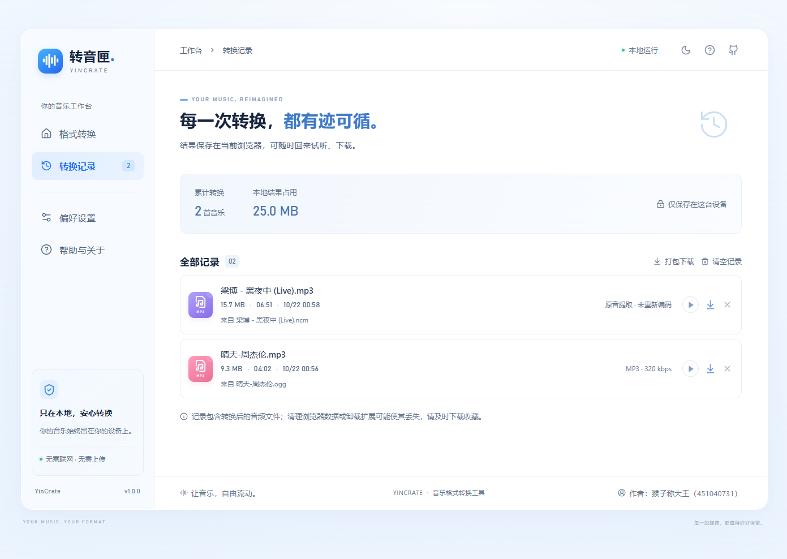

# 转音匣 YinCrate

一个在 **Microsoft Edge 浏览器内本地运行** 的音乐格式转换扩展。采用浅蓝色界面，支持拖拽上传、批量队列、实时进度、结果试听、单曲下载、ZIP 打包、转换记录与深色模式。




## 安装使用

**直接安装：** [下载 Edge 扩展安装包](https://github.com/451040731/YinCrate/blob/main/release)，解压后按下列步骤加载。

本地构建会生成 `dist/` 文件夹和 `release/YinCrate-v1.0.0-edge.zip`。源码仓库不包含 `dist/` 和依赖；如需从源码安装，请先执行开发章节中的 `npm ci` 和 `npm run build`。

1. 如使用 ZIP，请先解压到固定目录。
2. 在 Edge 地址栏输入 `edge://extensions`。
3. 打开左侧的“开发人员模式”。
4. 点击“加载解压缩的扩展”，选择 **包含 manifest.json 的 dist 文件夹**，或 ZIP 解压后的目录。
5. 在扩展菜单中点击“转音匣”，即可在独立标签页中打开工作台。可将扩展固定到工具栏。

将音乐文件拖入窗口，选择输出格式，点击“开始转换”。完成后可试听、逐个下载或打包下载。扩展内下载默认位于浏览器下载目录的 `YinCrate/` 文件夹；最终位置仍由浏览器下载设置决定。转换时请保持工作台标签页打开。

## 支持范围与音质

| 项目 | 行为 |
| --- | --- |
| 输入 | 常见 NCM、OGG（Vorbis / Opus）、FLAC、WAV、MP3、M4A、AAC、AIFF、OPUS、WMA；实际以文件内音轨及引擎可解码范围为准 |
| MP3 输出 | 默认 LAME 320 kbps，也可选择 256 / 192 / 128 kbps |
| FLAC 输出 | 无损整数音频编码，当前引擎最多 24 位；大于 24 位会报错并提示其他输出方式 |
| WAV 输出 | 根据源精度选择 16 / 24 / 32 位整数 PCM；浮点源需用原始音频模式保留精度 |
| 原始音频 | 普通音频直接保留字节；NCM 提取内部的 MP3 / FLAC，不重新编码 |
| 同格式保留 | 默认开启：当输出与实际音源格式一致，且采样率与声道均跟随源时，保留原始音频字节 |
| QQ 音乐 OGG | 支持普通 OGG；QMC、MGG、MFLAC 等加密音源暂不支持，改扩展名不能解密 |
| 单文件 / 队列 | 200 MB / 512 MB；在浏览器内逐首处理，以控制内存使用 |

**MP3 是有损格式，不存在“无损转 MP3”。** 320 kbps 可尽量保留听感，无法数学上无损。提高码率不能恢复原本丢失的信息。有无损需求时选择 FLAC / WAV，并保持源采样率和声道；修改这些参数会改变音频数据。有损音源转成 FLAC / WAV 也不会提高源音质。MP3 最高支持 48 kHz 与双声道，超过时会自动适配。

NCM 读取常见容器结构。新版加密、损坏文件可能不受支持。重新编码会复制引擎支持的文字标签，并补充 NCM 标题、歌手、专辑；封面、歌词和全部特殊标签不保证保留。原始音频模式保持提取出来的音频文件本身不变，不向其中补写 NCM 容器标签。

## 本地数据与权限

- 引擎、脚本、图标全部打包在扩展内；不使用 CDN、分析统计或远程转换接口。
- 音频仅由用户主动选择或拖入，不读取网页、账号、浏览记录或文件目录。
- 唯一请求的扩展权限是 `downloads`，用于保存转换结果。没有网页主机权限或内容脚本。
- 偏好设置保存在 localStorage，完成的结果（含音频 Blob）保存在 IndexedDB。
- 转换记录会占用本地浏览器存储；可在“转换记录”中删除或清空。存储不足时保留当前队列结果并提示下载。
- 关闭页面会中断当前任务；已保存记录在重新打开后可下载。卸载扩展、浏览器清理及系统存储回收可能删除本地数据，请及时备份。

## 开发

需要 Node.js 22.12+（建议 Node.js 24 LTS）。

```powershell
npm ci
node scripts/prepare.mjs
npm run dev
```

开发预览：`http://127.0.0.1:5173`。普通网页预览没有扩展的下载 API，会使用标准浏览器下载方式。实际扩展请加载构建后的 `dist/`。

```powershell
npm run build
npm test
npm run test:e2e
```

`build` 会复制本地 WebAssembly 音频引擎、生成 PNG 图标、构建页面并生成 ZIP。完整引擎约 32 MB，启动时从扩展本地加载。无需本机安装 FFmpeg；自动测试生成对照样本时需要命令行 `ffmpeg` 与 `ffprobe`。

Windows 上端到端测试默认使用已安装的 Edge，在独立临时扩展环境中运行真实 WASM 引擎。其他系统需先执行 `npx playwright install chromium`。测试使用自行生成的音频及合成 NCM 容器，检查格式输出、原始字节保留、无损 PCM 比对、记录持久化、取消重试、错误文件及下载。没有拿到用户真实下载的 NCM/OGG 样本，因此不能替代对特定平台版本文件的兼容性验证。

源码入口：`src/main.jsx`；音频引擎：`src/lib/converter.js`；NCM 解析：`src/lib/ncm.js`；扩展清单：`public/manifest.json`。开源组件及对应源码见 [THIRD_PARTY_NOTICES.md](THIRD_PARTY_NOTICES.md)。当前交付为可侧载扩展，未提交到 Edge 商店。
